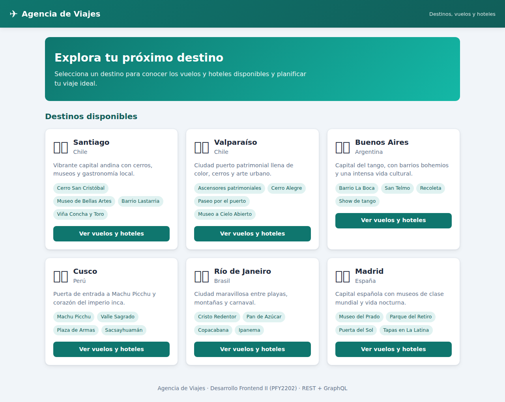
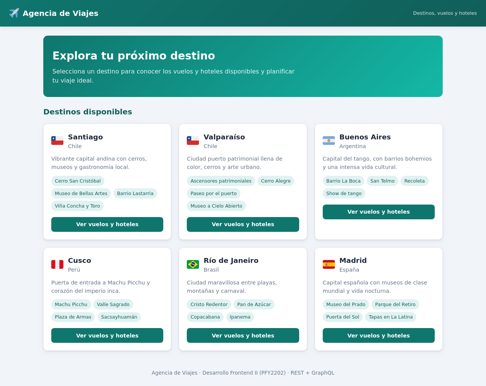
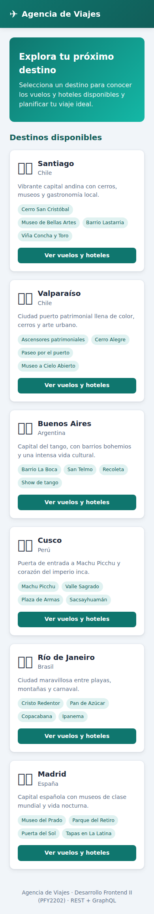
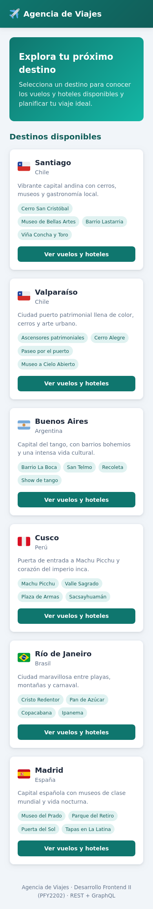
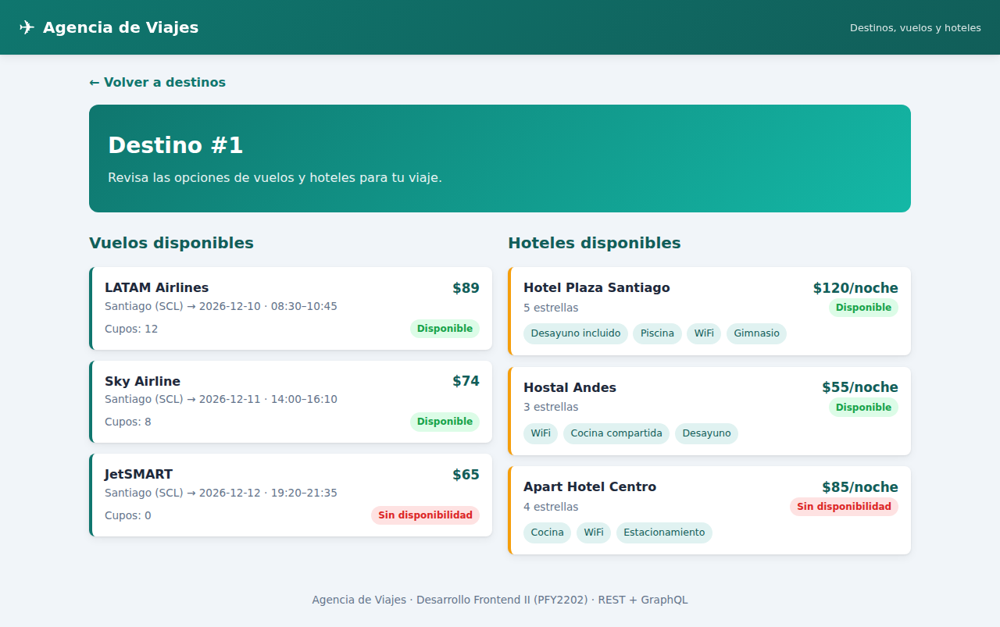
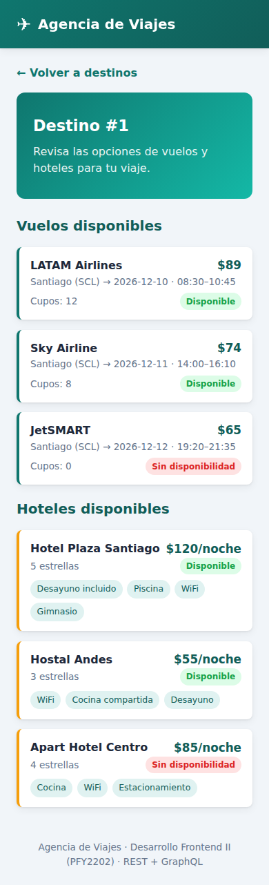

# Agencia de Viajes — Integrando nuestro frontend con backend

Actividad sumativa · Semana 5 · **Desarrollo Frontend II (PFY2202)**.

Aplicación de agencia de viajes construida con **React** que permite explorar **destinos** (país y actividades populares), y consultar los **vuelos** y **hoteles** disponibles para cada destino, comunicándose con un backend de tipo **mock** mediante **REST** y **GraphQL**.

## Tecnologías

| Herramienta | Uso |
|---|---|
| React 19 + Vite | Interfaz (componentes funcionales + hooks). |
| React Router DOM 7 | Navegación SPA entre vistas. |
| MSW (Mock Service Worker) 3 | Backend mock para REST y GraphQL. |
| Apollo Client 4 + GraphQL | Consultas GraphQL a vuelos y hoteles. |
| CSS puro (responsivo) | Estilos y diseño responsive. |

## Funcionalidades

- **Listado de destinos** (REST): obtiene los destinos desde una API REST mock (`GET /api/destinos`) con país, ciudad, descripción y actividades populares.
- **Detalle de vuelos y hoteles** (GraphQL): al seleccionar un destino, consulta una API GraphQL mock (`query GetViaje`) con los vuelos (aerolínea, fechas, horarios, precio y disponibilidad) y hoteles (categoría, precio por noche, disponibilidad y servicios).
- **Navegación** con React Router (`/` y `/destino/:id`).
- **Manejo de estado** con `useState`/`useEffect` (REST) y `useQuery` (GraphQL), incluyendo estados de carga y de error.

## Requisitos

- Node.js 18 o superior.
- npm.

## Instalación y ejecución local

```bash
npm install
npm run dev
```

Abre la URL que muestra Vite (por defecto `http://localhost:5173/viajes-nicolas-cavieres-PFY2202/`).

## Compilar para producción

```bash
npm run build
```

## Desplegar en GitHub Pages

```bash
npm run deploy
```

El proyecto queda publicado en `https://nicolasarielcc.github.io/viajes-nicolas-cavieres-PFY2202/`.

> Nota: se usa `HashRouter` para que la navegación por rutas funcione sin configuración extra del servidor en GitHub Pages (evita el error 404 al recargar una subruta). Los mocks de MSW se habilitan también en producción para que la app muestre datos reales (simulados) en el despliegue.

## Estructura del proyecto

```
viajes/
├── public/
│   └── mockServiceWorker.js      # Service Worker de MSW
├── screenshots/                  # Evidencia de pruebas en navegadores
├── src/
│   ├── components/               # Componentes reutilizables
│   │   ├── Layout.jsx
│   │   ├── Navbar.jsx
│   │   ├── DestinationCard.jsx
│   │   ├── FlightCard.jsx
│   │   ├── HotelCard.jsx
│   │   ├── Loading.jsx
│   │   └── ErrorMessage.jsx
│   ├── data/
│   │   └── destinos.js           # Datos simulados (destinos, vuelos, hoteles)
│   ├── graphql/
│   │   ├── client.js             # Configuración de Apollo Client
│   │   └── queries.js            # Definición de la query GraphQL
│   ├── mocks/
│   │   ├── handlers.js           # Handlers MSW (REST + GraphQL)
│   │   └── browser.js            # setupWorker
│   ├── pages/
│   │   ├── Home.jsx              # Listado de destinos (REST)
│   │   └── Destino.jsx           # Vuelos y hoteles (GraphQL)
│   ├── App.jsx                   # Rutas (HashRouter + ApolloProvider)
│   ├── main.jsx                  # Bootstrap + habilitación de MSW
│   └── index.css                 # Estilos y diseño responsive
└── vite.config.js                # base: '/viajes-nicolas-cavieres-PFY2202/'
```

## Backend mock

- **REST** — `GET /api/destinos` → lista de destinos.
- **GraphQL** — `query GetViaje($destinoId: ID!)` → `{ vuelos, hoteles }` del destino solicitado.

## Pruebas en navegadores y diseño responsivo

La aplicación fue verificada de forma automatizada (Playwright) en **dos motores de navegador** — **Chromium** (motor Blink, base de Google Chrome y Microsoft Edge) y **Firefox** (motor Gecko) — en **tres formatos responsivos**: escritorio, tablet y móvil.

En cada combinación se validó:

- Carga del listado de destinos vía **REST** (6 destinos).
- Carga del detalle de vuelos (3) y hoteles (3) vía **GraphQL**.
- Navegación fluida entre vistas con React Router.
- Ausencia de errores de consola y de desbordamiento horizontal (`scrollWidth` ≤ ancho de viewport).

### Matriz de compatibilidad

| Navegador | Motor | Escritorio (1280×800) | Tablet (768×1024) | Móvil (390×844) |
|---|---|---|---|---|
| Chromium (Chrome / Edge) | Blink | ✅ | ✅ | ✅ |
| Firefox | Gecko | ✅ | ✅ | ✅ |

> El proyecto usa solo APIs web estándar (CSS Grid/Flexbox, ES Modules, `fetch`, Service Worker), por lo que es compatible también con WebKit/Safari.

### Capturas

**Listado de destinos — escritorio (1280×800)**

| Chromium | Firefox |
|---|---|
|  |  |

**Listado de destinos — móvil (390×844)**

| Chromium | Firefox |
|---|---|
|  |  |

**Detalle de vuelos y hoteles (GraphQL)**

| Escritorio (Chromium) | Móvil (Chromium) |
|---|---|
|  |  |

> El directorio [`screenshots/`](screenshots/) contiene la evidencia completa de las 12 combinaciones probadas (2 navegadores × 3 viewports × 2 vistas).
